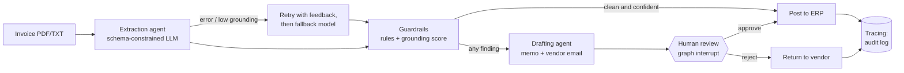

# Procurement Invoice Audit: Agents, Grounding & Human-in-the-Loop

A local LLM reads supplier invoices in many different layouts; **deterministic code makes every control decision**; anything that is not clean pauses for a human controller. Every decision is written to an append-only audit trail. Runs fully local (Ollama), so no invoice data leaves the machine.

## Executive summary

| | |
|---|---|
| **Problem** | Accounts Payable and audit teams manually check each invoice against the master services agreement (rates, payment terms, tax, duplicates). Slow, inconsistent, error-prone. |
| **Approach** | LLM for reading and drafting only. Rules engine for compliance. Humans for exceptions. |
| **Key design choice** | The system can *approve* a clean, high-confidence invoice on its own, but can **never reject or pay an exception without a reviewer**. |
| **Safety nets** | Schema validation, retry with feedback, model fallback, a grounding check on every extracted number, template fallback for drafts. |
| **Governance** | JSONL audit trail: input hash, models used, findings, reviewer name, final status. |
| **Privacy** | Local models via Ollama. No invoice data leaves the machine. |

## Layout

```
audit/
  agents.py        Agents       extraction agent + drafting agent
  grounding.py     Grounding    every extracted number must appear in the source text -> confidence
  rules.py         Guardrails   11 deterministic compliance rules, risk score, routing decision
  workflow.py      Workflows    LangGraph graph, human-review pause, tracing audit log
  schemas.py       Settings and Pydantic models
scripts/
  run_demo.py      Process one invoice, with an interactive reviewer prompt
  batch_run.py     Process a folder of invoices
  layouts.py       6 invoice layouts + generator for sample and edge-case invoices
  evaluations.py   Seeded-fault benchmark, with results broken down per layout
tests/test_audit.py   25 tests, no LLM required
data/
  contracts/apex_msa.json
  invoices/            original samples (txt, pdf)
  invoices/batch/      16 generated invoices: 6 layouts x clean/faulty + 4 edge cases
```

## How it works

Invoice checking is a fixed pipeline, not an open-ended task, so there is no free-roaming agent. Two steps need language understanding (reading the invoice, drafting prose) and use an LLM. Everything that decides money (rate cards, terms, arithmetic, tax, duplicates) is plain code that an auditor can read and a test can pin down. A graph runtime is used for one reason: the *pause for human approval with saved state*.



| Component | Technique | Failure handling |
|---|---|---|
| Extraction agent | Schema-constrained output into a `Decimal` domain model | 2 attempts per model with the error fed back; fallback model; best attempt kept |
| Grounding | Each extracted number must appear verbatim in the source (formats, currency symbols ignored) | Confidence below 0.90 can never auto-approve |
| Guardrails | Vendor, duplicate, currency, payment terms, rate card per line, uncontracted items, line/sub/grand totals, tax rate | Pure functions, unit-tested |
| Risk score | Noisy-OR over severities, plus amount at risk | Bounded in [0, 1] |
| Drafting agent | Sees findings only, never the raw invoice | Deterministic template if the LLM fails |
| Human review | LangGraph `interrupt` + checkpointer | Invalid decisions are refused and the invoice stays reviewable; approving an invoice that failed extraction is refused |
| Tracing | JSONL: input hash, models, findings, reviewer, final status | Append-only |

### Routing rules

- **APPROVE (auto-post):** no findings and extraction confidence at least 0.90.
- **REJECT (recommended to the reviewer):** duplicate invoice or vendor mismatch.
- **MANUAL_REVIEW:** any other finding, low confidence, or failed extraction.

## Run it

```powershell
pip install -r requirements.txt
ollama pull qwen2.5:7b
ollama pull llama3.1:8b          # fallback model (or set $env:AUDIT_FALLBACK_MODEL="qwen2.5:7b")

# one invoice, with interactive Approve/Reject
python scripts\run_demo.py data\invoices\inv_violations.txt

# a whole folder, then decide the review queue
python scripts\layouts.py                      # (re)generate sample invoices into data\invoices\batch
python scripts\batch_run.py --review --reviewer your.name

# tests (no LLM needed) and the benchmark
pytest
python scripts\evaluations.py --n 150
```

`batch_run.py` prints one line per invoice (outcome, recommendation, confidence, risk, findings) and writes `batch_results.csv`. It keeps a running list of invoice IDs, so a repeated ID is flagged as a duplicate. With `--review`, each queued exception is shown with its findings and draft memo, and the reviewer chooses Approve, Reject, Skip or Quit. Decisions are recorded with the reviewer's name in `audit_log.jsonl`.

## Invoice layouts and edge cases

| Layout | What it stresses |
|---|---|
| `classic` | One line per item: `40 hrs @ $175.00/hr = $7,000.00` |
| `table` | Pipe-separated columns, tax shown as a percentage |
| `european` | `7.000,00` number format, "45 days net" |
| `prose` | An email; vendor name only in the signature |
| `totals_first` | Summary on top, key-value line items below |
| `noisy_scan` | Random spacing, scan banner, distractor numbers (PO, phone, bank account) |

Edge cases in `data/invoices/batch/`: missing grand total, OCR-garbled digits (`7,0OO.00`), a non-invoice email, and a duplicate of an earlier invoice. The expected behaviour for all of them is to escalate to a human, never to auto-approve.

## Evaluation

`scripts/evaluations.py` builds invoices within contract limits, injects 0 to 2 of 7 faults (rate breach, wrong terms, subtotal, tax, duplicate, uncontracted item, line total), renders each in a random layout, runs the real pipeline, and compares the findings with those the rules produce from the ground-truth invoice. `--mock` replaces the LLM with ground truth and only validates the harness; its numbers are meaningless.

Metrics: finding precision and recall, **false-approval rate** (a faulty invoice that would be paid automatically; must stay at 0), false-escalation rate (a clean invoice sent to a human), extraction failures, and mean extraction latency. Results are reported overall and per layout.

**Baseline, single layout** (`classic` only; 50 synthetic invoices, 30 with seeded faults; qwen2.5:7b via Ollama):

| Metric | Result |
|---|---|
| Finding precision / recall | 1.0 / 1.0 |
| False-approval rate | 0.0 |
| False-escalation rate | 0.0 |
| Mean extraction latency | 1.6 s |

**Multi-layout results** (n=150; 92 faulty, 58 clean; qwen2.5:7b via Ollama):

| Layout | n | Recall | False-approval | False-escalation | Extraction failures |
|---|---|---|---|---|---|
| classic | 22 | 1.0 | 0.0 | 0.0 | 0 |
| table | 24 | 1.0 | 0.0 | 0.0 | 0 |
| european | 30 | 1.0 | 0.0 | 0.0 | 0 |
| prose | 23 | 1.0 | 0.0 | 0.0 | 0 |
| totals_first | 27 | 0.913 | 0.0 | 0.1 | 0 |
| noisy_scan | 24 | 1.0 | 0.0 | 0.0 | 0 |

### Analysis & Mitigations

* **Zero False Approvals[cite: 2]:** The system maintained a strict 0.0 false-approval rate across all 150 invoices. This proves the deterministic guardrails and confidence thresholds successfully act as a hard safety net, ensuring no non-compliant invoices are ever auto-posted to the ERP.
* **Weak Spot (`totals_first`):** The `totals_first` layout showed a minor degradation, with recall dropping to 0.913 and false escalations rising to 10% (0.1). This indicates the LLM occasionally struggles to cleanly associate summary-level totals at the top of the page with the line-item breakdowns further down, leading the rules engine to flag a mismatch and unnecessarily route the invoice to a human. 
* **Next Steps:** To reduce the false-escalation friction on this specific layout, I plan to inject a few-shot example of a `totals_first` invoice into the extraction agent's system prompt, or conditionally route low-confidence `totals_first` extractions to a heavier fallback model (e.g., Llama 3.1 70B or Qwen 2.5 32B) before escalating to the controller.

## Business case (Mid-Market Enterprise Example)

**Assumptions:**
* **Volume:** 100,000 invoices processed per year.
* **Manual Effort:** 10 minutes (average manual review & contract matching time per invoice).
* **Escalation Rate:** 15% (Assuming 15% of real-world invoices contain true faults or trigger the LLM's low-confidence threshold; 85% are processed straight-through).
* **FTE Cost:** $60/hour (Fully loaded cost for an AP Specialist / Auditor).
* **Overbilling Leakage:** $200,000/year (historical contract leakage recaptured by deterministic rate-cap enforcement).
* **Run Cost:** $12,000/year (Amortized local GPU compute/hosting for Ollama; $0 API token costs).
* **Build Cost:** $150,000 (Initial consulting engagement and integration).

**Calculations (Year 1):**
* **Hours saved/yr** = 100,000 invoices × 10 mins × (1 - 0.15 escalation) / 60 
  * 1,000,000 total mins × 0.85 / 60 = **14,166 hours saved/yr** (approx. 7 FTEs unlocked)
* **Saving** = 14,166 hours × $60/hour = **$850,000 / yr**
* **ROI** = (Saving + Recovered Overbilling - Run Cost - Build Cost) / (Run Cost + Build Cost)
  * ($850,000 + $200,000 - $12,000 - $150,000) / ($12,000 + $150,000)
  * $888,000 / $162,000 = **5.48**

**Conclusion:** 
Deploying ProcurePulse AI yields a **548% Year 1 ROI**, reaching a breakeven point in approximately 2 months, while permanently eliminating variable SaaS API costs through local deployment.

## Known limitations and next steps

- The review queue is in memory: skipped invoices are lost when the script ends. Production would use a durable checkpointer and a review UI or ticket queue.
- Text-based PDFs only; scanned documents need OCR (for example Azure Document Intelligence).
- One contract per run; production would look up the contract by vendor ID.
- Duplicate detection uses an in-run ledger or a passed-in list; production would query the AP ledger.
- No three-way match against purchase orders and goods receipts yet.
- Grounding confirms a number appears in the document, not that it sits in the right field; the arithmetic rules usually catch a misplaced value.
- Synthetic layouts are still synthetic; real vendors vary far more.
- Foundry migration path (not done here): swap Ollama for Foundry-hosted models, export traces via OpenTelemetry, run evaluations with `azure-ai-evaluation`.
